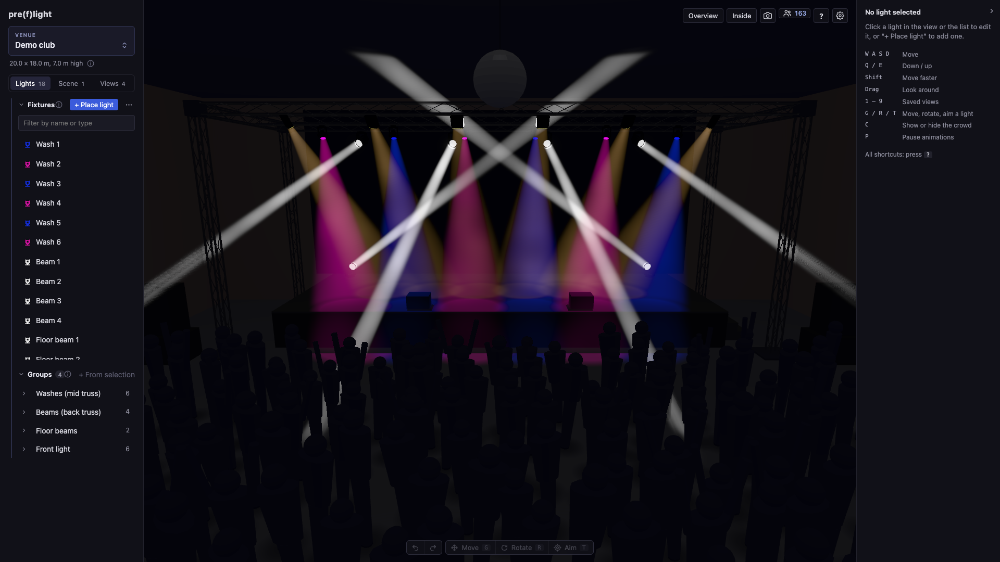

# pre(f)light

Lighting previz in the browser. Import a venue as a glTF model (from Blender and most 3D programs) or from SketchUp, hang lights from a library of about 640 real fixtures, drive their parameters and see them rendered as real-time lights with haze, from any camera position.



It is mainly a **planning tool**, not a live visualizer: image quality comes before frame rate, and 20-30 fps with a large rig is acceptable (though it often runs much faster). Using it live is a bonus.

pre(f)light runs on your own machine: a small Node server keeps your venues on disk and the client runs in the browser. There is no hosted version. It is developed and tested on macOS; Windows and Linux instructions are below but **untested so far**.

- [What it can do today](#what-it-can-do-today)
- [Getting started](#getting-started)
- [Venue models](#venue-models)
- [The SketchUp SDK](#the-sketchup-sdk)
- [How it is put together](#how-it-is-put-together)
- [Limits to know about](#limits-to-know-about)
- [Planned](#planned)
- [Contributing](#contributing)

## What it can do today

- **Venues:** upload a 3D model of the room: a glTF `.glb` (or a `.gltf` with everything embedded), which is used as it is, or a SketchUp `.skp`, which is converted to a 3D model with textures (see [Venue models](#venue-models)). The venue is the project: the sidebar shows the open venue and its lights, groups and camera views, and the venue name at its top opens the Venues window, where you switch, create, rename, reorder (drag), delete and replace the model of venues. Haze and room light are saved with each venue. Lights and groups can be copied to another venue (right-click a selection or a group, or "Import from another venue…" in the ⋯ menu next to "+ Place light"), keeping their coordinates.
- **Camera:** fly through the room (WASD / arrows, Q and E for down and up, Shift for fast, drag to look). Save named camera positions per venue and jump to them with the keys 1-9. A venue reopens where you left the camera. FOV is adjustable.
- **Fixture library:** "Place light" opens a picker with about 640 fixtures from the [Open Fixture Library](https://open-fixture-library.org): search by name or manufacturer, filter by type, by what a fixture has (pan/tilt, zoom, focus, color, gobo, prism, strobe) and by manufacturer, and see its specs and DMX modes before placing it. Each fixture brings its real beam angle range (and fixtures without focus optics get a soft beam edge, softer the wider the beam), pan/tilt travel and light output into the preview, and the inspector only offers the controls it has. Each fixture is drawn as a simple body built from its type and its real dimensions (a moving head with a yoke, a scanner, a can-style par, a panel, a bar or a box), so a big wash and a small spot differ in size and shape. Fixtures that are not moving heads are placed as a fixed light with a spot-style beam (bars and panels get a flat sheet of light instead (and cast shadows from their middle, like any other light, when they have one of the shadow slots)), and smoke machines, hazers, fans, dimmer packs and stands are placed as plain bodies that light nothing. A generic moving head is always available at the top of the list.
- **Lights:** place fixtures on any surface (ceiling, truss, wall, floor) by clicking. Set dimmer, color, zoom, focus (the distance at which the beam edge is sharpest, soft nearer and farther), pan and tilt. Move and rotate each light with a gizmo (G / R); hold Shift to snap rotation to 5 degrees. Duplicate, rename and delete lights.
- **Tech rider import (optional, uses AI):** the ⋯ next to "+ Place light" reads a PDF tech rider (patch table and lighting plan) and drafts the lights from it, which you review, match to fixtures from the library and adjust by hand before they are placed. Reading the plan uses the Anthropic API with your own API key, entered in that window and kept in your browser (or set as `ANTHROPIC_API_KEY` for the server). The rest of the app needs no key and no internet connection.
- **Atmosphere and look:** haze makes beams visible in the air (each beam is drawn as a smooth volume that starts at the lens and widens at the zoom angle, with soft edges, brighter when you look down it, and cut by surfaces) and also thins out distant surfaces with a light fog; a haze-wisps slider makes the haze drift and vary along the beams, a room-light slider stands in for house lights, and a surface-light slider (in stops) sets how strongly lights illuminate surfaces separately from how visible the beams are, which helps with dark materials. Tone mapping (Neutral keeps colors true, ACES is the filmic curve) keeps overlapping beams from clipping to white, with an exposure slider in stops, and bloom gives lenses and bright pools a soft glow.
- **Shadows:** up to 10 lights at once cast real shadows, on surfaces and in the haze (objects block beams, with light shafts between table legs). You choose which lights under "Casts shadows" in the light's panel, and there is a master switch in the settings. The other lights are unshadowed.
- **Quality and export:** renders at a size you choose in the settings (your display's native resolution by default, or 3/4, 2/3, 1/2, 1/3 or 1/4 of it) and lowers it briefly while things move, only if needed to stay near 30 fps and no lower than a second size you choose (1/4 by default). Both dropdowns show the resulting pixel size. A camera button saves a high-resolution PNG that is always 16:9 (1x, 2x or 4x the view's pixel density, capped by GPU limits). It is the middle part of what you see, with the same bloom and fog: a window wider than 16:9 loses its left and right edges, a narrower one its top and bottom. A small frame-rate counter (bottom right, refreshed every second) can be switched off in the settings, as can the soft fade of beams where they meet surfaces.
- **Performance:** around 120 lights run at roughly 55-60 fps on an M1 Pro with plain clustered lighting. With the full look (bloom, tone mapping, anti-aliasing) at native resolution on a Retina display, 120 lights idle at roughly 11 fps and the view drops to a lower render size while moving. A typical rig is much lighter.

### Layout

The sidebar on the left holds the open venue in three pages: **Lights** (fixtures and groups), **Scene** (crowd zones with the crowd's density and movement, and model tags) and **Views** (saved camera views). Each section folds with its title (remembered in the browser), and a long light list scrolls on its own, with a filter box (by name or fixture type) once there are more than 8 lights. "+ Place light" opens the fixture library; the ⋯ next to it imports a tech rider or lights from another venue.

The panel on the right is the inspector for the selected lights, in four parts (Output, Beam, Position, Setup). The numbers next to dimmer, zoom, focus, pan and tilt can be typed, in %, degrees or meters (Enter sets, Esc puts it back). With nothing selected it lists the main keys, and its arrow folds it to give the view more room. In the light list each light shows the outline of its body type in its color (dimmer as brightness) and, when it came from a rider patch, its DMX universe and address. At the bottom middle of the view are undo and redo and the tools for the selection (Move, Rotate, Aim); above them a line says what the next click in the view does (placing a light, aiming, drawing a zone) with a Cancel button, and short messages such as "Deleted 3 lights · Undo" appear there too. Deleting asks nothing: the message offers Undo. The buttons at the top right jump the camera, save a screenshot, show or hide the crowd, list every keyboard shortcut (?) and open the settings. When there is nothing to show (no venue yet, or a venue without a model), the view says so and offers the next step. Settings are grouped into Camera, Atmosphere, Look, Quality and Preferences (the last two start folded); values marked "venue" are saved with the venue, the rest in the browser. Every change to a venue is saved a moment after you make it, with no save button; if the server cannot be reached, a line under the venue name says the changes are not saved yet, and they are sent as soon as it can be.

### Controls

The small ⓘ icons next to section titles and settings explain them in a tooltip (hover or Tab to them; a click shows it on a touch screen, and Esc closes it). Messages that tell you what to do right now, and warnings, stay visible.

| Input | Action |
|---|---|
| W A S D / arrow keys | Move |
| Q / E | Down / up |
| Shift (while moving) | Faster |
| Drag | Look around |
| 1-9 | Jump to a saved view |
| Click a light | Select it |
| Ctrl-click or Cmd-click, Shift-click (in the list or the 3D view) | Add a light to the selection or take it out (Shift-click in the list selects a range) |
| Ctrl+A / Cmd+A | Select all lights |
| G / R | Move / rotate gizmo for the selected light, or for the whole selection (it turns the lights about the middle of the selection) |
| Shift (while rotating) | Snap to 5 degrees |
| Delete | Remove the selected light or the whole selection (the message that follows offers Undo) |
| Ctrl/Cmd+Z, Shift+Ctrl/Cmd+Z (or Ctrl+Y) | Undo and redo edits to the lights and groups (also the arrow buttons at the bottom of the view) |
| T, then click a surface | Aim the selected lights at that point (a crosshair shows where) (moving heads by pan and tilt, other lights by turning them); with several lights selected, the Spread and Fan sliders then spread the beams out. Esc cancels |
| P | Pause or resume every animation (crowd movement, haze drift, strobe flashes, gobo spin; also "Animations" in Settings) |
| C | Show or hide the crowd (zones are drawn with "+ Zone" under Crowd in the sidebar; density and movement are below the zones; the crowd button at the top right does the same as C) |
| Click a group (Ctrl/Cmd-click to add) | Select the lights of a saved group, in the group's order; "+ From selection" in the Groups section saves the current selection as one |
| Esc | Close the open popover, else cancel what the next click would do (place a light, aim, draw a zone, pick a point for a rider plan), else deselect |
| ? | List every keyboard shortcut |
| Right-click a venue | Rename |
| Right-click a saved view | Rename, update to the current camera, delete |
| Right-click a light in the list | Rename, duplicate, delete (with several selected: duplicate or delete all) |

## Getting started

### Requirements

- [Node.js](https://nodejs.org) 22 or newer (with npm).
- A recent desktop browser with WebGL 2 (Chrome, Edge, Safari or Firefox). A dedicated or Apple silicon GPU helps with large rigs.
- Only for SketchUp files: the SketchUp C SDK, CMake 3.20 or newer and a C++20 compiler (macOS and Windows only). See [The SketchUp SDK](#the-sketchup-sdk). glTF venues need none of this.

### Install and run

```
git clone <this repository>
cd preflight
npm install
npm run dev
```

The client runs on http://localhost:5173 and the server on port 3001. To use another port for the server, set `PORT` for both, for example `PORT=3002 npm run dev`; the client follows it. If port 5173 is taken, Vite picks the next free one and prints it. Open the client and click **Open the demo club** to look around a ready-made venue: a small club with a stage, a truss rig and 18 lights already hung and aimed, with haze, a crowd and saved views (keys 1-4). It can be added again at any time from the bottom of the Venues window. For your own venue, create one in the Venues window and upload a `.glb` file. That is all you need for glTF venues, on every platform. SketchUp files also need the converter (see [The SketchUp SDK](#the-sketchup-sdk)).

There is no login, so both only accept connections from the same machine by default. To reach pre(f)light from another device, start the client with `npm run dev -w client -- --host` (in place of `npm run dev`, with `npm run dev:server` alongside): the client then listens on your network and passes API calls to the server on the same machine. Only do that on a network you trust, since anyone who can reach it can change every venue. Set `HOST=0.0.0.0` only if something else must talk to the server directly. The server also refuses requests from other websites: a request must be addressed to this machine or an IP address, and come from the page it is sent to. If you open pre(f)light by a host name instead of an IP address (such as `studio-mac.local`), list that name in `PREFLIGHT_ALLOWED_HOSTS` (comma-separated) for the server, and in Vite's [`server.allowedHosts`](https://vite.dev/config/server-options#server-allowedhosts) for the client.

### Tests

```
npm test -w shared
npm test -w server
npm test -w client
npm run test:e2e
```

The first three are unit tests; the server's include its routes, tested over HTTP. `test:e2e` opens the demo club in a headless Chromium, checks that it renders, and uses the view as a person would (moving the camera, selecting and aiming lights, placing one, drawing a crowd zone, the rider wizard's plan view); it fails on any error the page logs. It starts its own server and client on ports 3199 and 5199, with a scratch data folder, so your venues are never touched. Install the browser once with `npx playwright install chromium`.

`npm run check` runs everything CI runs except the browser test: formatting, lint, unused code, type checks, unit tests and the client build.

## Venue models

- **glTF (`.glb`), works everywhere.** Export from Blender with File > Export > glTF 2.0, format "glTF Binary (.glb)", and the default "+Y Up": glTF is in meters with Y up, which is what the viewer expects, so model the room at real size in meters. A `.gltf` works too when its data and textures are embedded in it; one that refers to separate `.bin` or image files is refused, so export a `.glb` instead. Lights, cameras and animations in the file are ignored. The file is checked and stored as it is, with no conversion.
- **SketchUp (`.skp`), needs the converter.** The converter turns inches into meters and SketchUp's Z-up into Y-up, and keeps materials, textures and tags. It needs the SketchUp SDK, below.
- **Hiding parts:** the Scene tab lists the parts of the model so you can hide some, such as a ceiling in the way. For a SketchUp model these are its tags. For a glTF model they are its top-level objects (in Blender: the objects that have no parent), or the children of the one object that holds everything when there is only one. Name and group the objects in Blender the way you want to switch them.

## The SketchUp SDK

This is only needed for SketchUp files; glTF venues work without it. A small native program in `converter/` (`skp2glb`) reads the `.skp` with Trimble's SketchUp C SDK and writes a GLB model, which the server then serves to the viewer. The SDK is free to download, but its license doesn't let this project ship it, so you download it yourself and unpack it as `SketchUp_SDK/` in the repository root. That folder is git-ignored. Don't commit it or redistribute builds that include it: read Trimble's [developer terms](https://www.trimble.com/legal/developer-terms) and the terms included in the SDK first.

### Getting it

1. Go to the [SketchUp SDK page](https://extensions.sketchup.com/developer_center/sketchup_sdk) in the SketchUp developer center and sign in with a (free) Trimble ID.
2. Download the **SketchUp C SDK** for your platform. Trimble publishes it for **macOS and Windows only**.
3. Use the newest release (version 27 or newer): files saved by a recent SketchUp may not open with an older SDK.

The downloads are sometimes offline for maintenance, or available only through a request form on that page. If you can't get the current version, ask on the [SketchUp developer forum](https://forums.sketchup.com/c/developers/sketchup-sdk/).

### macOS

1. Install the Xcode command line tools (`xcode-select --install`) and CMake (for example `brew install cmake`).
2. Unpack the SDK so that `SketchUp_SDK/SketchUpAPI.framework` exists in the repository root.
3. If macOS refuses to load the library ("code signature not valid", "disallowed by system policy"), clear the download quarantine flag:
   ```
   xattr -dr com.apple.quarantine SketchUp_SDK
   ```
4. Build the converter from the repository root:
   ```
   cmake -S converter -B converter/build -DCMAKE_BUILD_TYPE=Release
   cmake --build converter/build
   ```

If a build that used to work fails after a macOS or Xcode update, delete `converter/build` and build again: CMake remembers the path of the old macOS SDK.

### Windows (untested)

1. Install [Visual Studio 2022](https://visualstudio.microsoft.com) (the free Community edition is enough) with the **Desktop development with C++** workload. It includes CMake and the v143 toolset the SDK is built with. The SDK is 64-bit only.
2. Unpack the SDK so that `SketchUp_SDK\headers` and `SketchUp_SDK\binaries\sketchup\x64\SketchUpAPI.lib` exist in the repository root.
3. Open the **x64 Native Tools Command Prompt for VS 2022** and build from the repository root:
   ```
   cmake -S converter -B converter/build -A x64
   cmake --build converter/build --config Release
   ```
   This writes `converter\build\skp2glb.exe` and copies the SDK's DLLs (`SketchUpAPI.dll` and the others it needs) next to it.
4. If the converter fails to start because `MSVCP140.dll` or a similar file is missing, install the [Microsoft Visual C++ Redistributable](https://learn.microsoft.com/cpp/windows/latest-supported-vc-redist) (x64).

### Linux (untested)

Trimble doesn't publish the SketchUp SDK for Linux, so the converter can't be built there. Use glTF venues instead: open the `.skp` in SketchUp (or another program that reads it) on a Mac or Windows machine and export a `.glb`. Or let pre(f)light convert it there and copy the venue over: create and upload the venue on the Mac or Windows machine, then copy its folder `server/data/venues/<id>/` (it holds `venue.json`, `model.skp` and `model.glb`) into `server/data/venues/` on the Linux machine and restart the server.

## How it is put together

- `client/`: Vue 3, Vite, TypeScript, Pinia and Babylon.js. Rules and maths with no framework (fixture profiles, the crowd model, the undo history) are in `client/src/domain/`. The 3D code is in `client/src/scene/`, one controller per job (fixture rig, crowd, camera, venue model, look, gizmo, rider plan view and markers) beside the beam shader, adaptive quality and screenshots; `components/Viewer.vue` connects them to the state in `client/src/stores/`.
- `server/`: Node with a REST API and a WebSocket (reserved for live DMX later). It stores venues, checks uploaded glTF models, runs the converter for SketchUp files and serves the fixture catalog. The rider import is in `server/src/rider/`.
- `server/catalog/`: a snapshot of the fixture catalog from the [Open Fixture Library](https://open-fixture-library.org) (about 640 fixtures, with the library's MIT license next to it), plus `custom.json` for fixtures that aren't in the library yet. To refresh it: `npm run import-fixtures -w server -- --download` (clones only the library's `fixtures/` folder into a temp folder and rebuilds the catalog), or pass the path of an existing checkout instead of `--download`, then restart the server.
- `shared/`: the types the client and the server exchange, and the plan-to-venue maths both use (the workspace `@preflight/shared`, plain TypeScript without a build step).
- `converter/`: the native SketchUp-to-GLB program (see [converter/README.md](converter/README.md)). Only needed for SketchUp files.
- `samples/`: the demo club (`demo-club.glb` and `demo-club.json`), made by `npm run demo-venue -w server` from `server/src/tools/demoVenue.ts`. The model is original and covered by the project's license.
- `docs/roadmap.md`: what is planned.
- `docs/architecture.md`: how the parts fit together, which way dependencies point, and the known problems in the structure.
- `docs/engineering.md`: the guidelines a change is reviewed against, and the checks that enforce them.

Data lives in `server/data/venues/<id>/` (git-ignored): `venue.json` (name, order, saved views, fixtures) and `model.glb`, the model the viewer loads: a glTF upload as it was uploaded, or a SketchUp upload converted (then the uploaded `model.skp` is kept next to it). Uploading an identical SketchUp file again skips the conversion, unless the converter has been rebuilt since (then it converts again, so a better converter reaches existing venues when you re-upload their file). Fixture parameters are stored as normalized values from 0 to 1, like DMX channels, which keeps the door open for live DMX input.

Viewer preferences (FOV, exposure, bloom, resolution options) and the remembered camera positions are stored in the browser, not on the server. Haze and room light are saved with each venue.

SketchUp files and the `venues/` folder for local samples are git-ignored: a venue model is usually someone else's property, so keep it out of the repository.

## Limits to know about

- Light brightness is approximate: intensity is compressed so zoom changes stay visible without clipping, so it is not a photometric simulation. Exposure is a slider, not a calibrated camera.
- A screenshot takes a few seconds at the larger sizes (the view is re-rendered at that size), and very large sizes depend on the GPU.
- Only 10 lights can cast shadows at once. Thin shadows in the haze (like table legs far from the light) show as fine grain rather than clean sheets, while large ones (a table, a person) have crisp edges.
- Beams stop at floors, walls and ceilings, but through an opening such as an arch a beam keeps going for its full 25 m length. They cost a few milliseconds per frame (about 4 ms with 13 lights at native resolution on an M1 Pro), more with many overlapping wide beams.
- SketchUp files need the SketchUp SDK, which exists for macOS and Windows only. glTF works everywhere.
- A glTF model must be a single file (`.glb`, or `.gltf` with everything embedded). Models compressed with Draco or meshopt load the decoder from Babylon.js's CDN, so they need an internet connection.
- There is no login and no user separation: anyone who can reach the server can see and change every venue.

## Planned

Details, effort estimates and the list of rendering ideas are in [docs/roadmap.md](docs/roadmap.md). In short:

1. **Core:** fine pan/tilt for the fixture library; DMX patch data with conflict checks; more editing comfort.
2. **Rendering polish:** further beam and haze detail (tone mapping, bloom, fog, soft beam edges, volume beams, shadows, haze wisps and sheet-shaped beams are done).
3. **Import:** tech riders and patch plans (MVR first; PDF with AI assistance behind a review step is underway).
4. **Crowd:** seated blocks, other zone shapes, a density per zone (a standing crowd in rectangular zones, with density and movement options, is done).
5. **Much later:** live Art-Net / sACN input, scenes and cue lists for an animated light show preview, and AI help for scenes.

## Contributing

Bug reports, ideas and pull requests are welcome. See [CONTRIBUTING.md](CONTRIBUTING.md) for how to set up, test and submit changes, and [SECURITY.md](SECURITY.md) for how to report a security problem.

## License

pre(f)light is licensed under the [GNU Affero General Public License v3.0 or later](LICENSE): you may use, change and share it, and if you run a changed version as a service for others, you have to offer them its source code. The SketchUp converter in `converter/` is under the [MIT License](converter/LICENSE), because it links Trimble's proprietary SketchUp SDK. The fixture catalog in `server/catalog/` comes from the Open Fixture Library under its [MIT License](server/catalog/OFL-LICENSE.txt).

pre(f)light is not affiliated with Trimble or SketchUp. SketchUp is a trademark of Trimble Inc.
