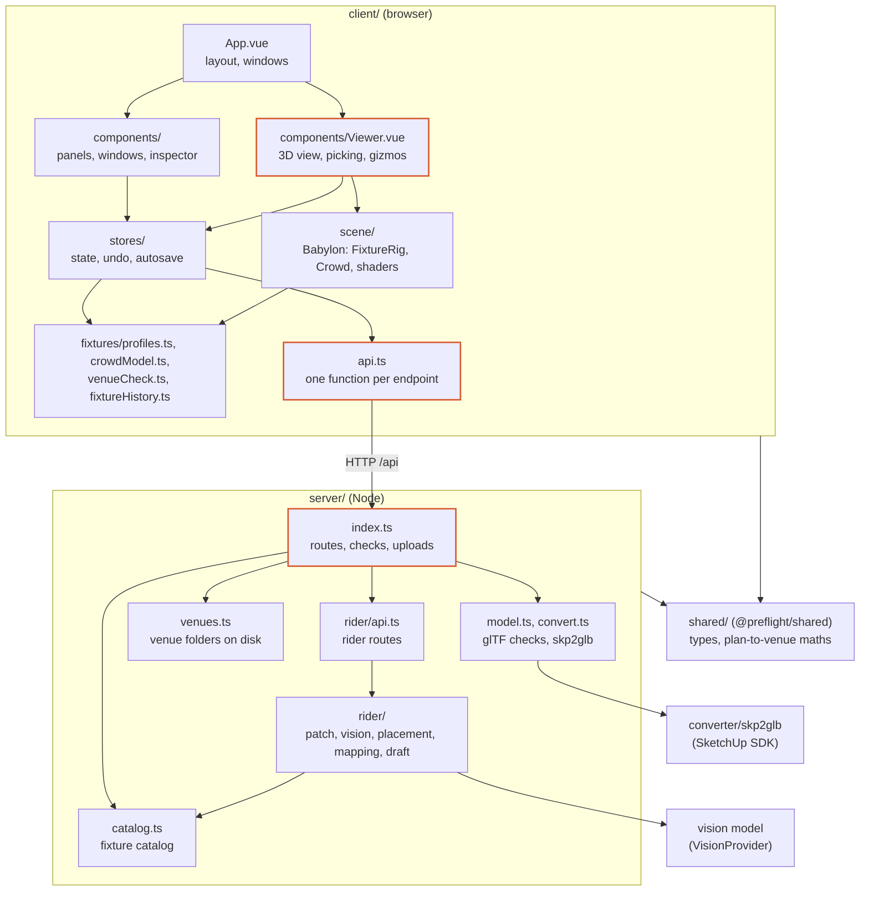

# Architecture

Status: describes the code as of November 2026. [Direction](#direction) is a plan; of its steps, only the first (`shared/`) is built. Update this file when a change moves a boundary between the parts below, so it stays a map you can trust.

pre(f)light is two programs: a browser client that draws the venue and lets you place and edit lights, and a small Node server that stores venues, converts models and reads tech riders. They talk over a JSON API under `/api`; in development Vite passes `/api` and `/ws` on to the server (`client/vite.config.ts`). The shape of what they exchange, and the maths both apply to it, are in a third package, `shared/`.



Arrows point from the code that imports to the code it uses. The three outlined boxes are where most of the [known problems](#known-problems) are.

## The client

| Layer | Where | What it does | May import |
|---|---|---|---|
| Shell | `main.ts`, `App.vue` | Mounts the app, lays out the sidebar, view and inspector dock, and opens windows (picker, venues, rider import, transfer) when a store says so. | everything below |
| Components | `components/*.vue` (26) | Panels, windows and the inspector. They read stores and call store actions. Most of their length is CSS: the larger ones have 170 to 240 lines of script. | stores, domain, `shared/` |
| Viewer | `components/Viewer.vue` | Owns the Babylon engine, scene, camera and gizmos. Turns store state into scene calls (watchers) and clicks and drags into store actions. | stores, scene, domain |
| Stores | `stores/` (11 Pinia stores) | What the app knows: venues, the lights of the open venue with selection and undo, crowd, rider import, settings, layout. They save to the server shortly after the last change. | domain, `api.ts`, `shared/`; scene types only |
| Scene | `scene/` | Babylon objects: `FixtureRig` (lights, beams, shadows, gobos), `Crowd`, the beam shader, gobo patterns, fixture body models, adaptive render size, screenshots. | domain, `shared/` |
| Domain | `fixtures/profiles.ts`, `crowdModel.ts`, `venueCheck.ts`, `atmosphere.ts`, `stores/fixtureHistory.ts` | Rules and maths about lights, crowds and venues, with no Vue or Babylon in them (with one exception, see below). | `shared/` |
| API | `api.ts` | One function per endpoint. | `shared/` |

The `venues` store is the hub: it holds every venue record, and the `rig`, `crowd` and `rider` stores work on parts of the open one (`venues.current.fixtures`, `.groups`, `.crowd`). Settings, layout, the open venue, camera positions and the vision API key are kept in the browser's `localStorage`; everything else is saved on the server.

## The server

| Module | What it does |
|---|---|
| `index.ts` | The HTTP server: refuses requests from other sites (`origin.ts`), routes by matching the path, checks request bodies (the `clean…` functions), receives and converts models, and opens the WebSocket (reserved for live DMX). |
| `http.ts` | `HttpError`, `readJson`, `sendJson`. |
| `origin.ts` | Which hosts and origins may talk to the server (there is no login). |
| `venues.ts` | Venue storage: one folder per venue, writes to a venue queued one after another and replaced in one step. |
| `model.ts`, `convert.ts` | Checks glTF uploads and packs a `.gltf` into a `.glb`; runs the native `skp2glb` converter. |
| `catalog.ts` | Loads the fixture catalog (the Open Fixture Library snapshot plus `custom.json`). |
| `demo.ts` | Makes the demo club venue from `samples/`. |
| `rider/` | The tech rider import. `api.ts` has the routes. `patch.ts` reads the patch table from the PDF's text, `vision/` reads the plan page with a vision model behind the `VisionProvider` interface, `placement.ts` works out where and how a light drawn on the plan hangs, `mapping.ts` matches rider names to catalog fixtures, and `draft.ts` turns all of it into proposed lights. |
| `tools/` | Command-line scripts (`npm run import-fixtures`, `demo-venue`, `read-rider` and others) that reuse the modules above. |

Each venue is a folder `server/data/venues/<id>/` with `venue.json` (everything but the files), `model.glb`, `model.skp` for SketchUp uploads, and `rider.pdf` and `rider.json` once a rider is imported. New files are written next to the old ones and renamed over them only when they are complete, so a failed upload or conversion leaves the venue as it was.

## Shared code

`shared/` is the npm workspace `@preflight/shared`, which both the client and the server depend on. It holds what both sides must agree on, so it is declared once:

| Module | What it holds |
|---|---|
| `venue.ts` | A venue and what it contains: lights (`Fixture`) and their patch, groups, saved views, haze and room light, the crowd. |
| `catalog.ts` | The fixture catalog as the server sends it. |
| `rider.ts` | The rider file, and the drafts of lights the server makes from it. |
| `similarity.ts` | The map from plan pixels to venue meters: the client works it out from the two calibration points, the server places the lights with it. |

It is plain TypeScript with no build step: its `package.json` points at `src/index.ts`, which Vite, `tsx` and both type checkers read directly. Nothing in it may import Node, the DOM, Vue or Babylon, so it runs the same on both sides. Its tests run on `node:test`, like the server's.

## How a change travels

Changing a light's dimmer in the inspector:

1. The inspector calls `rig.setValue(id, 'dimmer', 0.8)`.
2. `rig` calls `touch()`, which records an undo step at the end of the current tick, then changes the fixture inside `venues.current.fixtures` and schedules a save.
3. 400 ms after the last change, `rig` sends every light and group of the venue with `PUT /api/venues/<id>/fixtures`.
4. The server checks every field (`cleanFixtures`, `cleanGroups`) and `updateVenue` writes `venue.json`.
5. Meanwhile a watcher in `Viewer.vue` sees the fixtures change and calls `fixtureRig.sync(fixtures, haze)`, which creates, updates or removes Babylon nodes to match.

The other direction: a click in the view goes to `Viewer.vue`'s pointer handler, which decides what it means (place a light, aim, pick a crowd corner, pick a rider calibration point, or select) and calls the matching store action. A finished gizmo drag calls `rig.update()` with the new position or rotation.

The rider import runs across both programs: the server reads the patch table from the uploaded PDF and, on request, the plan with a vision model; the client shows the plan picture, the user clicks two points on the plan and the same two in the venue, the client works out the transform from those pairs, the server builds drafts of the lights from it, `Viewer.vue` previews them as markers, and `rider.importNow()` adds them through `rig.importLights()` as one undo step.

## Patterns to follow

- **The scene follows the state.** `FixtureRig` is about 1,000 lines behind a small interface: `sync(fixtures, haze)` makes the scene match the data, and `rootOf`, `pivotOf` and `dispose` cover the rest. Nothing outside it has to know how lights, shadows and gobos are built. New scene code should look like this.
- **Babylon objects stay out of Vue's reactivity.** `Viewer.vue` keeps the engine, scene and camera in plain variables, and the camera bridge uses `shallowRef`. Vue would otherwise wrap every engine object in a proxy, which is slow and breaks identity checks.
- **Logic that needs no framework lives without one.** `FixtureHistory` is a plain class that the `rig` store drives, so undo can be tested without Vue.
- **Pipelines of plain functions.** The server's rider import is a chain of small stages with data in and data out, and the vision model is an interface with one implementation per vendor. Most of the server's tests are here, because this shape makes testing easy.
- **Check data where it enters.** The server checks every request body for type, range and size before it is stored, and refuses requests from other sites.
- **Replace files in one step.** Uploads and conversions are written next to the old file and renamed over it only when they worked.

## Known problems

In order of how much they get in the way.

1. **`Viewer.vue` does too much.** About 1,400 lines of script and 30 watchers cover engine setup, the camera and remembered positions, model loading and hidden tags, picking, gizmos and moving several lights at once, rotation snapping, the aim cursor, the rider plan view (including the triangle analysis that hides clutter), rider markers, crowd zone drawing, post-processing and screenshots. A change to any of these means reading all of it.
2. **What a click does is spread over five flags in three stores.** `rig.placing`, `rig.aim.armed`, `crowd.picking`, `crowd.drawing` and `rider.pickingWorld` each switch on a mode. The pointer handler in `Viewer.vue` gives them a priority with a chain of `if`s, and the Escape key in `FixturesPanel.vue` repeats that order. Nothing stops two modes from being on at once.
3. **The stores and the viewer talk in four different ways.** The camera store holds an interface the viewer registers (`camera.api`); the viewer puts a function into the rider store (`rider.ceilingAt`); the rig store bumps a counter the viewer watches (`rig.aim.tick`), after which the viewer solves the aim and calls `rig.applyAim()`; and the mode flags above. Each works, but a reader has to learn all four.
4. **The server's `index.ts` does three jobs.** It routes requests, holds about 130 lines of body checks that can only be tested from outside, over HTTP (`index.test.ts`), and runs the model upload with its three cases (glTF, a new SketchUp file, a replacement SketchUp file). The rider routes have already moved to `rider/api.ts`. `receiveModel` here and `receivePdf` in `rider/api.ts` repeat the same streaming size and format check. `readJson` returns `any`, which is why the checks read `raw.x` without the compiler's help. The types of what is sent are shared now, but nothing checks at run time that a body has that shape: schemas in `shared/` could do it for both sides.
5. **A few imports cross layers the wrong way.**
   - `fixtures/profiles.ts` imports `modelFor` and `lensStrip` from `scene/fixtureModel.ts`, a module that imports Babylon, so the domain layer depends on the scene layer.
   - `profiles.ts` keeps the catalog in a module-level map and makes callers reactive with `void profilesVersion.value`; the `catalog` store would be the natural owner.
   - `FixtureInspector.vue` and `SettingsPanel.vue` import light limits (`MAX_SHADOW_LIGHTS`, `MAX_GOBO_LIGHTS`) from `scene/FixtureRig.ts`.
   - `scene/aim.ts` mixes the pan and tilt maths with lookups on a `FixtureRig`, so the maths cannot be tested without a scene.
6. **Keyboard shortcuts are scattered.** The app-wide keys (`?`, C, P, T, G, R, Escape, Delete, Ctrl/Cmd+A, undo and redo) are handled in `FixturesPanel.vue`, a sidebar list; six other components, `Viewer.vue` among them, add their own window listeners. The list of shortcuts is written out three times: `HelpPanel.vue`, the empty inspector in `App.vue`, and the README.
7. **Saving works three slightly different ways.** Lights are saved 400 ms after the last change, haze and crowd 500 ms after it, each with its own timer. Saved views and hidden tags go back to the old value when saving fails; lights, haze and crowd keep the new value and show an error.

The client's tests cover its plain logic (undo, profiles, crowd, venue check, aiming; plan calibration is tested in `shared/`) but no store or component, and the browser test only checks that the demo club renders. Before the refactors in [Direction](#direction) move code, each needs tests around what it moves.

## Direction

Where the code should go, so that each problem above has a home:

```
shared/            types and plan-to-venue maths (done); request schemas next, with the server split
client/src/
  domain/          profiles, crowd model, venue check, fixture history: no Vue, no Babylon, unit-tested
  scene/           one controller per job (camera, model, gizmos, rider plan, crowd zones), each with attach and dispose
  stores/          one value for the interaction mode; one autosave helper
  input/           one keymap that the handlers and the help panel both read
  components/      Viewer.vue only wires stores to scene controllers
server/src/
  routes/          venues.ts, rider.ts
  services/        venue storage, model upload and conversion, catalog
  rider/           the pipeline, unchanged
```

Dependencies point down only: components → stores → domain and `shared/`; the viewer → scene → domain and `shared/`; server routes → services → `shared/`. Once linting is set up, a tool such as dependency-cruiser can check this in CI.

Suggested order, smallest risk first:

1. **`shared/` workspace** for the types and the plan-to-venue maths. Done: the client and the server no longer keep copies that drift apart.
2. **One interaction mode and one keymap.** Small changes that make the click and key handling readable.
3. **Split the server's routes, checks and upload handling.** The checks become schemas in `shared/` on the way, so the client can use them too.
4. **Split `Viewer.vue` into scene controllers.** The largest change; the browser smoke test (`e2e/smoke.spec.ts`) has to keep passing at every step, and should grow with the interactions each step moves.
