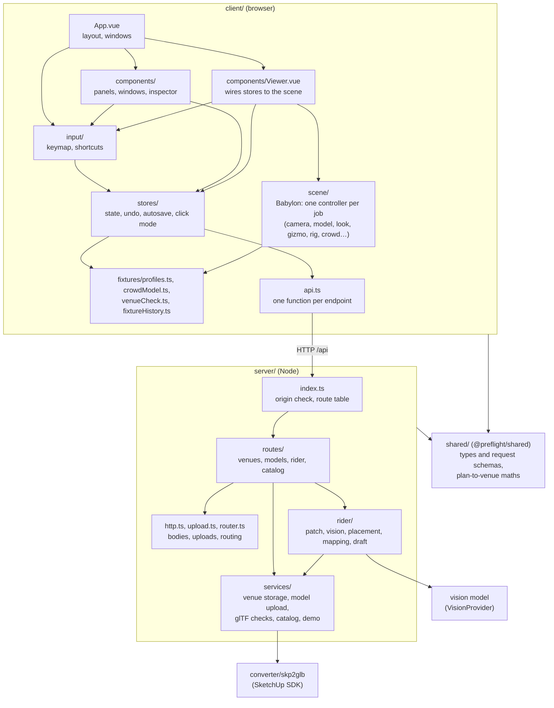

# Architecture

Status: describes the code as of November 2026. [Direction](#direction) is a plan; the four steps of its suggested order are built, and its `domain/` folder and one autosave helper are not. Update this file when a change moves a boundary between the parts below, so it stays a map you can trust.

pre(f)light is two programs: a browser client that draws the venue and lets you place and edit lights, and a small Node server that stores venues, converts models and reads tech riders. They talk over a JSON API under `/api`; in development Vite passes `/api` and `/ws` on to the server (`client/vite.config.ts`). The shape of what they exchange, and the maths both apply to it, are in a third package, `shared/`.



Arrows point from the code that imports to the code it uses.

## The client

| Layer | Where | What it does | May import |
|---|---|---|---|
| Shell | `main.ts`, `App.vue` | Mounts the app, lays out the sidebar, view and inspector dock, and opens windows (picker, venues, rider import, transfer) when a store says so. | everything below |
| Components | `components/*.vue` (26) | Panels, windows and the inspector. They read stores and call store actions. Most of their length is CSS: the larger ones have 170 to 240 lines of script. | stores, `input/keymap.ts`, domain, `shared/` |
| Viewer | `components/Viewer.vue` | Makes the engine and the scene controllers, passes store state to them in watchers, turns their callbacks and the clicks in the view into store actions (routing a click by the click mode), and disposes them. It builds no Babylon objects itself but the engine and the depth pass. | stores, scene, domain, `input/keymap.ts` |
| Input | `input/` | `keymap.ts` lists every app-wide shortcut and gesture with its help text, and matches key presses (plain TypeScript). `shortcuts.ts` is the one key listener for the app, set up by `App.vue`, which runs the matching store action. | stores (`shortcuts.ts` only) |
| Stores | `stores/` (12 Pinia stores) | What the app knows: venues, the lights of the open venue with selection and undo, crowd, rider import, settings, layout, and what the next click in the view does (`interaction`). They save to the server shortly after the last change. | domain, `api.ts`, `shared/`; scene types only (`CameraState`, `RotationReadout`) |
| Scene | `scene/` | Babylon, one controller per job, each a class that builds its objects, takes plain data and callbacks (no stores) and has a `dispose`: `FixtureRig` (lights, beams, shadows, gobos), `Crowd`, `ViewerCamera` (walking, jumps, the pose remembered per venue), `VenueModel` (loading, parts, everything about what is under the pointer), `Look` (post-processing, fog, room light), `SelectionGizmo`, `AimCursor`, `ZoneOutlines`, `RiderPlanView`, `RiderMarkers`. Beside them the beam shader, gobo patterns, fixture body models, adaptive render size, screenshots, and plain maths (`planClutter.ts`, aiming). | domain, `shared/` |
| Domain | `fixtures/profiles.ts`, `crowdModel.ts`, `venueCheck.ts`, `atmosphere.ts`, `stores/fixtureHistory.ts` | Rules and maths about lights, crowds and venues, with no Vue or Babylon in them (with one exception, see below). | `shared/` |
| API | `api.ts` | One function per endpoint. | `shared/` |

The `venues` store is the hub: it holds every venue record, and the `rig`, `crowd` and `rider` stores work on parts of the open one (`venues.current.fixtures`, `.groups`, `.crowd`). Settings, layout, the open venue, camera positions and the vision API key are kept in the browser's `localStorage`; everything else is saved on the server.

## The server

| Module | What it does |
|---|---|
| `index.ts` | The entry: refuses requests from other sites (`origin.ts`), hands the rest to the route table, turns an `HttpError` into its status and message, and opens the WebSocket (reserved for live DMX). |
| `router.ts` | The route table: `{ method, path, handler }` entries with `:name` parts in the path; 404 for an unknown path, 405 for a method a path does not take. |
| `http.ts` | `HttpError`, `sendJson`, and `readBody`, which checks a JSON body against its schema from `shared/` and answers 400 with what does not fit and where. |
| `upload.ts` | `receiveFile`: streams a raw upload to disk, hashing it and checking its size and first bytes as it arrives. Models and rider PDFs both use it. |
| `routes/` | One file per area, each a list of routes: `venues.ts` (the venue and what is saved with it), `models.ts` (upload, convert again, fetch the GLB), `rider.ts` (the tech rider import), `catalog.ts`. A handler finds the venue (`venueOf`, a 404 when there is none), reads its body, calls a service and sends the answer. |
| `services/` | What the routes do, with no HTTP in it. `venues.ts` is venue storage: one folder per venue, writes to a venue queued one after another and replaced in one step. `modelUpload.ts` puts an uploaded model in place in its three cases (glTF, a first SketchUp file, a replacement) and converts a stored one again. `model.ts` checks glTF and packs a `.gltf` into a `.glb`, `convert.ts` runs the native `skp2glb` converter, `catalog.ts` loads the fixture catalog (the Open Fixture Library snapshot plus `custom.json`), and `demo.ts` makes the demo club from `samples/`. |
| `rider/` | The tech rider pipeline. `patch.ts` reads the patch table from the PDF's text, `vision/` reads the plan page with a vision model behind the `VisionProvider` interface, `placement.ts` works out where and how a light drawn on the plan hangs, `mapping.ts` matches rider names to catalog fixtures, and `draft.ts` turns all of it into proposed lights. |
| `tools/` | Command-line scripts (`npm run import-fixtures`, `demo-venue`, `read-rider` and others) that reuse the modules above. |

Each venue is a folder `server/data/venues/<id>/` with `venue.json` (everything but the files), `model.glb`, `model.skp` for SketchUp uploads, and `rider.pdf` and `rider.json` once a rider is imported. New files are written next to the old ones and renamed over them only when they are complete, so a failed upload or conversion leaves the venue as it was.

## Shared code

`shared/` is the npm workspace `@preflight/shared`, which both the client and the server depend on. It holds what both sides must agree on, so it is declared once:

| Module | What it holds |
|---|---|
| `venue.ts` | A venue and what it contains: lights (`Fixture`) and their patch, groups, saved views, haze and room light, the crowd. What the client sends is a zod schema, and its type is inferred from it; `Venue` itself, which only the server makes, is an interface. |
| `requests.ts` | The body of every JSON request, by route, as a schema; and `check`, which returns a value as its schema makes it (names trimmed, rotations at length 1) or what is wrong with it and where. |
| `catalog.ts` | The fixture catalog as the server sends it. |
| `rider.ts` | The rider file (with a schema that checks the parts the import reads), and the drafts of lights the server makes from it. |
| `similarity.ts` | The map from plan pixels to venue meters: the client works it out from the two calibration points, the server places the lights with it. |

It is plain TypeScript with no build step: its `package.json` points at `src/index.ts`, which Vite, `tsx` and both type checkers read directly. Its one dependency is [zod](https://zod.dev); nothing in it may import Node, the DOM, Vue or Babylon, so it runs the same on both sides. It is marked free of side effects, so the client's build leaves out the schemas it does not use (today all of them: the client imports types and the calibration maths). Its tests run on `node:test`, like the server's.

## How a change travels

Changing a light's dimmer in the inspector:

1. The inspector calls `rig.setValue(id, 'dimmer', 0.8)`.
2. `rig` calls `touch()`, which records an undo step at the end of the current tick, then changes the fixture inside `venues.current.fixtures` and schedules a save.
3. 400 ms after the last change, `rig` sends every light and group of the venue with `PUT /api/venues/<id>/fixtures`.
4. The route in `routes/venues.ts` reads the body with `readBody(req, fixturesBody)`, which checks every field against the schemas in `shared/` and returns them tidied; it drops group members that are not among the lights, and `updateVenue` writes `venue.json`.
5. Meanwhile a watcher in `Viewer.vue` sees the fixtures change and calls `fixtureRig.sync(fixtures, haze)`, which creates, updates or removes Babylon nodes to match, and another puts the selection gizmo back on the selected lights.

The other direction: a click in the view goes to `Viewer.vue`'s pointer handler, which reads `interaction.mode`, the one value that says what the next click does (place a light, aim, a crowd zone corner or facing point, a rider calibration point). It passes the point to the store that started that mode (`rig.placeAt`, `rig.aimAt`, `crowd.finishZone`, `rider.deliverWorld`…), which ends it; with no mode on, the click selects. The point comes from `VenueModel`, which knows what is under the pointer. A finished gizmo drag reaches `SelectionGizmo`'s `onMoved` callback, which calls `rig.update()` with each light's new position or rotation. A key press goes to the one listener in `input/shortcuts.ts`, which looks it up in `input/keymap.ts` and calls the store action.

The rider import runs across both programs: the server reads the patch table from the uploaded PDF and, on request, the plan with a vision model; the client shows the plan picture, the user clicks two points on the plan and the same two in the venue, the client works out the transform from those pairs, the server builds drafts of the lights from it, `RiderMarkers` previews them as spheres in the venue (while `RiderPlanView` looks down on it during calibration), and `rider.importNow()` adds them through `rig.importLights()` as one undo step.

## Patterns to follow

- **The scene follows the state.** `FixtureRig` is about 1,000 lines behind a small interface: `sync(fixtures, haze)` makes the scene match the data, and `rootOf`, `pivotOf` and `dispose` cover the rest. Nothing outside it has to know how lights, shadows and gobos are built.
- **A controller per job in the scene.** New scene code is a class in `scene/` like the others: it builds its Babylon objects in its constructor, takes plain data (`show(preview)`, `attach(ids)`) and reports through callbacks given to it, knows no store, and releases everything in `dispose`. `Viewer.vue` adds one variable, one line where the scene is made, its watchers and one line in the teardown. Its maths go in plain functions beside it, tested without a scene; the class itself can be tested on Babylon's `NullEngine` (see `SelectionGizmo.test.ts`).
- **Babylon objects stay out of Vue's reactivity.** `Viewer.vue` keeps the engine and the controllers in plain variables, and the camera bridge uses `shallowRef`. Vue would otherwise wrap every engine object in a proxy, which is slow and breaks identity checks.
- **Logic that needs no framework lives without one.** `FixtureHistory` is a plain class that the `rig` store drives, so undo can be tested without Vue. The keymap's matching is plain too.
- **One value for what a click does.** A new kind of click is a new case of `ClickMode` in `stores/interaction.ts`: the store that starts it also finishes it, the viewer's pointer handler gets one more `case`, and the edit bar's hint one more line. Starting a mode ends the one before, and Esc or opening another venue ends it, so two can never be on at once.
- **Keys live in the keymap.** A new app-wide shortcut is an entry in `input/keymap.ts` (keys, help text, group) and a handler in `input/shortcuts.ts`; the help panel, the empty inspector and button titles pick it up. A test fails if two shortcuts, or a shortcut and the camera, share a key. Only keys that mean something inside one window or field stay with it, and that window stops them from reaching the app.
- **Pipelines of plain functions.** The server's rider import is a chain of small stages with data in and data out, and the vision model is an interface with one implementation per vendor. Most of the server's tests are here, because this shape makes testing easy.
- **Check data where it enters.** Every JSON body goes through `readBody` and its schema in `shared/requests.ts` before a route uses it, and every upload through `receiveFile` as it streams in. Requests from other sites are refused before routing.
- **Routes are tables, services do the work.** A file in `server/src/routes/` is a list of `{ method, path, handler }`; a handler finds the venue, reads its body, calls a service in `services/` and sends the answer. A new endpoint is a new entry, and its body a new schema in `shared/requests.ts`.
- **Replace files in one step.** Uploads and conversions are written next to the old file and renamed over it only when they worked.

## Known problems

In order of how much they get in the way.

1. **The stores and the viewer talk in three different ways**, besides state the viewer watches (such as the click mode). The camera store holds an interface the viewer registers (`camera.api`); the viewer puts a function into the rider store (`rider.ceilingAt`); and the rig store bumps a counter the viewer watches (`rig.aim.tick`), after which the viewer solves the aim and calls `rig.applyAim()`. Each works, but a reader has to learn all three.
2. **A few imports cross layers the wrong way.**
   - `fixtures/profiles.ts` imports `modelFor` and `lensStrip` from `scene/fixtureModel.ts`, a module that imports Babylon, so the domain layer depends on the scene layer.
   - `profiles.ts` keeps the catalog in a module-level map and makes callers reactive with `void profilesVersion.value`; the `catalog` store would be the natural owner.
   - `FixtureInspector.vue` and `SettingsPanel.vue` import light limits (`MAX_SHADOW_LIGHTS`, `MAX_GOBO_LIGHTS`) from `scene/FixtureRig.ts`.
   - `scene/aim.ts` mixes the pan and tilt maths with lookups on a `FixtureRig`, so the maths cannot be tested without a scene.
   - `Viewer.vue` reads the rider wizard's panel width from the page (`aside[aria-label="Import tech rider"]`) to fit the plan view beside it; the layout store could own that size.
3. **Saving works three slightly different ways.** Lights are saved 400 ms after the last change, haze and crowd 500 ms after it, each with its own timer. Saved views and hidden tags go back to the old value when saving fails; lights, haze and crowd keep the new value and show an error.

The client's tests cover its plain logic (undo, profiles, crowd, venue check, aiming, the keymap, the plan view's fit and clutter cut, camera poses, how a light sits on a surface; plan calibration is tested in `shared/`), the click mode across the `rig`, `crowd` and `rider` stores, and the selection gizmo and rider markers on Babylon's `NullEngine`, but no component. The browser tests (`e2e/`) open the demo club and drive the view the way a person does: the camera, selecting and the gizmo, aiming, placing, drawing a crowd zone, hiding model parts, a screenshot, and the rider wizard's plan view and markers. Before a refactor moves code, it needs tests around what it moves.

## Direction

Where the code should go, so that each problem above has a home:

```
shared/            types, request schemas and plan-to-venue maths (done)
client/src/
  domain/          profiles, crowd model, venue check, fixture history: no Vue, no Babylon, unit-tested
  scene/           one controller per job (camera, model, look, gizmos, rider plan, crowd zones), each with dispose (done)
  stores/          one value for what a click does (done); one autosave helper
  input/           one keymap that the handlers and the help panel both read (done)
  components/      Viewer.vue only wires stores to scene controllers (done)
server/src/
  routes/          venues.ts, models.ts, rider.ts, catalog.ts (done)
  services/        venue storage, model upload and conversion, catalog (done)
  rider/           the pipeline, unchanged
```

Dependencies point down only: components → stores → domain and `shared/`; the viewer → scene → domain and `shared/`; server routes → services → `shared/`. A tool such as dependency-cruiser could check this in CI.

Suggested order, smallest risk first:

1. **`shared/` workspace** for the types and the plan-to-venue maths. Done: the client and the server no longer keep copies that drift apart.
2. **One interaction mode and one keymap.** Done: what the next click does is one value in `stores/interaction.ts`, and every app-wide key is in `input/keymap.ts`.
3. **Split the server's routes, checks and upload handling.** Done: routes are tables in `routes/`, the work is in `services/`, request bodies are checked against schemas in `shared/`, and one streaming check takes models and PDFs.
4. **Split `Viewer.vue` into scene controllers.** Done: browser tests for each interaction came first, then one controller at a time, each step tested in the browser. It turned up a bug on the way: the plan view hid the whole floor of a model drawn without an index buffer.
